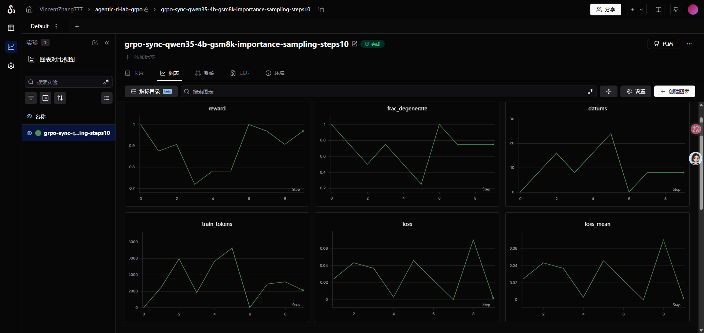
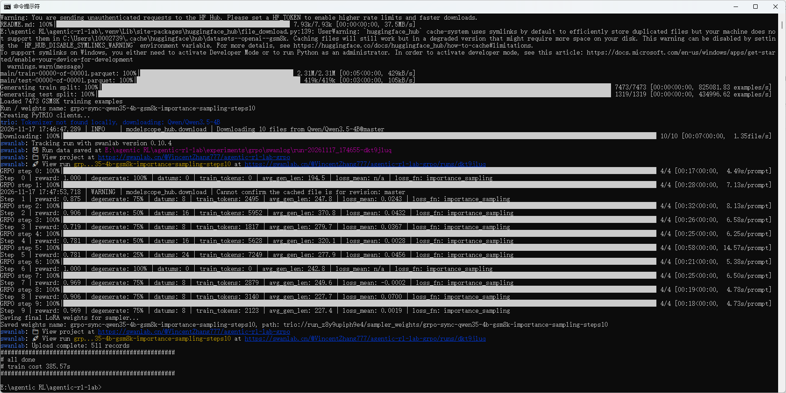

# Windows 跑通 GRPO｜Datawhale Task01 学习笔记

第一次跑大模型强化学习。我在 Windows 上用 `uv` 配好环境，用 PyTRIO 跑云端训练，再到 SwanLab 看曲线。本机没有用到 GPU。10 步实验大约跑了 **6 分 26 秒**，成功保存了 LoRA 权重。

## 📌 我是怎么跑起来的

1. **配环境。** 安装 `uv`，克隆 `agentic-rl-lab` 仓库，在仓库根目录运行 `uv sync`。我用的是 Python 3.13、PyTRIO 0.2.9 和 SwanLab 0.10.4。Windows CMD 跨盘切目录时记得用 `cd /d`。
2. **登录两个平台。** 分别执行 `uv run trio login` 和 `uv run swanlab login`，再用 `uv run swanlab verify` 检查 SwanLab 登录。
3. **跑 GRPO 示例。** 模型用 `Qwen3.5-4B`，数据集是 GSM8K，首次运行会自动下载。每步抽 4 道题，每道题生成 8 个回答。用 `online` 模式把曲线传到 SwanLab。 [Datawhale 入门教程](https://datawhalechina.github.io/agentic-rl-lab/experiments/getting-started/)

```cmd
uv run python experiments/grpo/01-demo-sync.py --steps 10 --batch-size 4 --group-size 8 --max-tokens 512 --swanlab-mode online
```

## 📈 实验结果

10 步里有 **8 步实际更新了参数**。整次实验采样了 40 组回答，其中 12 组提供了训练信号。每步的采样正确率在 **71.9% 到 100%** 之间波动。因为每步只有 4 道题，我把这次结果当作训练流程跑通的记录。要判断模型有没有变强，还得用同一批测试题比较训练前后的准确率。



最让我印象深刻的是 **第 0 步和第 5 步**。第 0 步全答对了，但每道题组内的 8 个回答得分都相同，减去组内平均分后，优势值全是 0，所以跳过了更新。第 5 步正确率是 **78.1%**，却有 3 道题的回答有对有错，提供了这次最多的训练 token，共 **7,249 个**。



所以我现在会把 `reward` 和 `train_tokens` 一起看。前者告诉我这批回答答对了多少，后者告诉我这一步有多少 token 真正参与训练。 [我的 SwanLab 实验曲线](https://swanlab.cn/@VincentZhang777/agentic-rl-lab-grpo/v1/rybok6/runs/dkt9jluq/chart)

\#Datawhale #组队学习 #GRPO #强化学习 #大模型 #SwanLab
